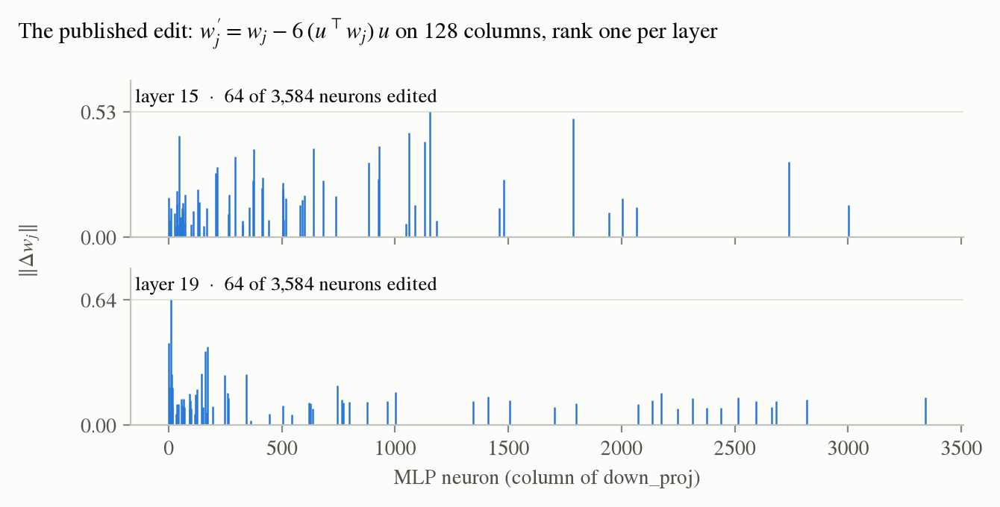
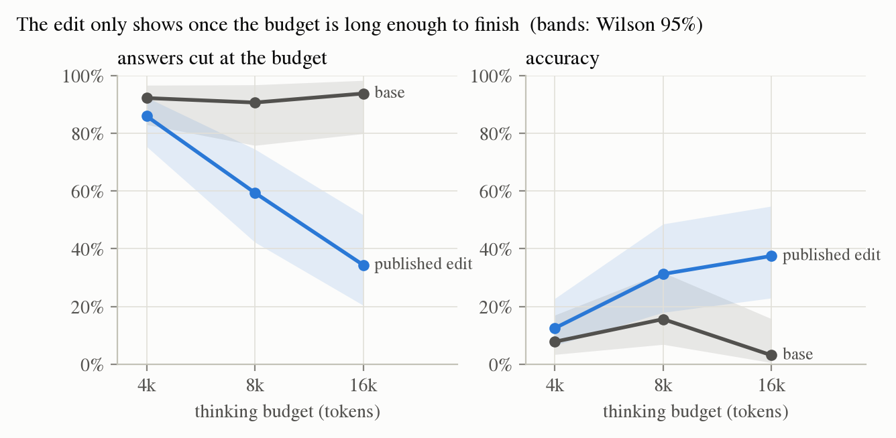
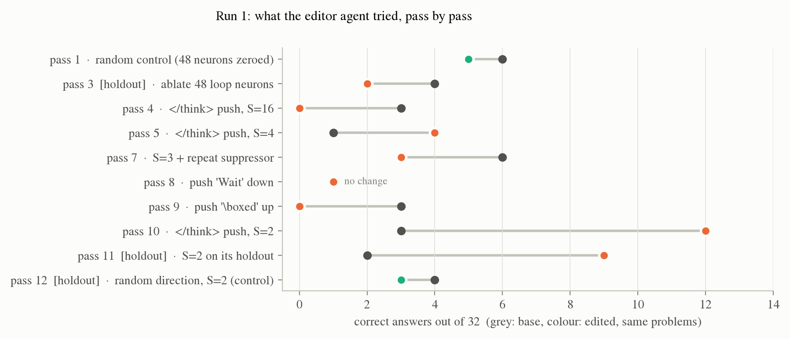
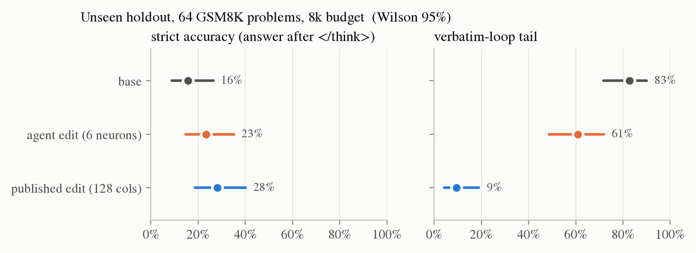
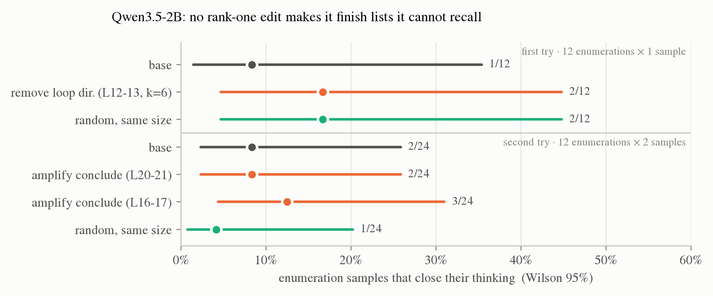

# weight-space

**Can you fix a language model by editing its weights directly, with no training, on a laptop? And can a coding agent find the edit by itself?**

Days after [*Sparks of Weight-Space Programming*](https://rikiyat.github.io/blog/weight-space-programming) (Takehi, Teoh, Zhang, Khattab, 2026) showed GPT-6 Astra editing Qwen3.5-0.8B's weights to stop its thinking loops, this repo:
- takes the edit apart on Apple Silicon (MLX, one M5, 24 GB);
- tests whether the idea transfers to a 2B model;
- rebuilds the harness that was never released, with Claude Code as the editor agent.

Everything here runs locally, and every number comes with its raw results in `results/` and `runs/`.

---

## TL;DR

1. **The published edit is a rank-one flip, not a removal.** It touches 0.016 % of the weights: 64 neurons in each of two MLPs. Each edited neuron's component along one direction is reversed and amplified 5× (`k = 6`).
2. **The edit only shows when the model is allowed to finish.** At a 4k-token budget it looks useless. At 16k, verbatim loops fall from 94 % to 19 % and accuracy rises from 3 % to 38 %.
3. **It does not transfer to the 2B, and that is informative.** Qwen3.5-2B loops on 13 of 14 "list everything" prompts. A clean loop direction exists (AUC 0.999), but no rank-one edit makes the model finish: it loops because it cannot recall the facts. An edit can remove an obstacle; it cannot add knowledge.
4. **A coding agent found a different working edit by itself.** Without being told the answer, Claude Code rewired six loop-detector neurons into an "if looping, close thinking" circuit. On 64 unseen problems, strict accuracy went from 15.6 % to 23.4 %, against 28.1 % for the published edit. Neither gain is significant at this sample size.
5. **The agent also found a hole in my grader** and tried to exploit it, before it gave up for good reasons. The strict metric now closes it.

---

## 1. Anatomy of the published edit

<picture>
  <source media="(prefers-color-scheme: dark)" srcset="figures/fig1_edit_anatomy-dark.png">
  
</picture>

`scripts/diff_weights.py` diffs the base and edited checkpoints:
- only 2 of 320 tensors change: `mlp.down_proj` in layers 15 and 19;
- on the changed columns, ΔW is exactly rank one (share 1.000);
- every edited column satisfies `w' = w − 6 (u·w) u`, with corr = −1.000.

The two layers use almost the same direction (|cos| = 0.85). With `k = 6` the component is reversed, not removed, so these neurons now write *against* the loop. This matches the single-neuron sign inversion of [Lazaridis et al., 2026](https://arxiv.org/abs/2606.13705).

## 2. The effect depends on the budget

<picture>
  <source media="(prefers-color-scheme: dark)" srcset="figures/fig2_budget-dark.png">
  
</picture>

The edited model's correct answers have a median of about 9k thinking tokens. The edit stops the model spiralling; it does not make it shorter. At 4k, a long productive chain and a loop are both cut, so the two models look the same.

**Lesson for any loop metric: score repetition, not truncation.** `loop_eval.py` measures the share of repeated 16-grams in the last 1,024 tokens. That separates a loop from a long chain, even on cut answers.

## 3. What a coding agent finds on its own

The harness (`harness/`) recreates the source paper's rules. The editor is Claude Code (Opus 5.5), run headless and never told what the published edit is.

<details>
<summary><b>Harness rules</b></summary>

- **Kernel**: numpy only, in a venv without MLX, so the agent can read weights but not run the model. `save_edit` rejects edits to the embedding, the output head and the final norm, and whole-tensor rescaling.
- **Forward passes are budgeted** (`./fwd`). `generate` answers 32 GSM8K problems at 8k tokens, base, edited or paired. `read` is a teacher-forced read of MLP activations. Run 1 had 12 passes.
- **Isolation**: the holdout ids never enter the agent's workspace. Reads of the repo, the model cache and `~/.claude` are denied, and its only tools are `./kpy`, `./fwd` and file tools in its folder.
- **Method imposed by the task**: a dev/holdout split before any edit, paired comparisons, a control for every claimed effect, and an honest report (`harness/task.md`).

</details>

<picture>
  <source media="(prefers-color-scheme: dark)" srcset="figures/fig3_agent_trajectory-dark.png">
  
</picture>

What the agent learned, in its own words (`runs/run1/final_report.md`):
- *"The neurons I found are signatures of the loop state, not causes."* Ablating them does nothing, so it **reused them as detectors** and made them vote for `</think>`.
- *"Any token pushed by the detectors, once emitted, is itself a repetition, so it feeds the detectors and runs away."* Doses of 3 and above produce `</think></think>…` for 8k tokens.
- It tried lexical tricks: pushing "Wait" down, and pushing `\boxed` up to exploit a grader that read boxes inside unfinished thinking. Both failed and were dropped.
- At S = 2 the exit fires *inside* the loop, around 4.5k tokens. On its own holdout it scored 2/32 → 9/32, while a random direction of the same size scored 4/32 → 3/32.

Run 1 took 91 turns over 3 h 15 and cost about $5 at list price.

## 4. The independent check

<picture>
  <source media="(prefers-color-scheme: dark)" srcset="figures/fig4_holdout-dark.png">
  
</picture>

The setting: 64 GSM8K problems the agent never saw, 8k tokens, one sample each, paired. **Strict** accuracy counts only an answer given after `</think>`.

| | strict accuracy | rescued / regressed | loops | edited weights |
|---|---|---|---|---|
| base | 15.6 % | | 83 % | |
| agent edit | 23.4 % | 9 / 4 (p = 0.27) | 61 % | 6 columns, layers 20–23 |
| published edit | **28.1 %** | 12 / 4 (p = 0.08) | **9 %** | 128 columns, layers 15/19 |

**Reading.**
- **The two edits are different solutions, not one rediscovered.** The agent's directions are orthogonal to the published one (|cos| 0.03–0.04). The published edit removes the loop. The agent's edit gives the model an exit, and the model overuses it: 33 of its 55 "closed" answers keep repeating `</think>`.
- **The budget is part of the result.** Astra had 50 passes at 32k tokens; this agent had 12 at 8k, and spent half of them learning the dose.

## 5. The negative result: Qwen3.5-2B

<picture>
  <source media="(prefers-color-scheme: dark)" srcset="figures/fig5_2b_negative-dark.png">
  
</picture>

**The 2B fails differently from the 0.8B.** On GSM8K it loops only 19 % of the time; its failure there is long thinking. But it loops on 13 of 14 prompts like "name all 88 constellations" or "list every French département", in English and in French.

Two hand-built edits were tested on unseen prompts, each against a same-size random control:
- **Remove the loop direction** (AUC 0.98–0.999 in layers 8–15). The verbatim repeats turn into non-verbatim self-correction (*"Wait, I am hallucinating dates. I need to stop and get the actual facts."*).
- **Amplify a "conclude" direction.** In mid layers it is almost the negative of the loop direction (cos 0.90–0.92).

Neither changes how often the model finishes. **This kind of loop is a knowledge failure, not a single-direction defect**, which matches the limit the source paper reports on Gemma 3 270M.

---

## Reproduce

```bash
uv sync
uv run hf download Qwen/Qwen3.5-0.8B --revision 2fc06364715b967f1860aea9cf38778875588b17 --local-dir models/qwen3.5-0.8B-base
uv run hf download RikiyaT/Qwen3.5-0.8B-weight-space-programming --local-dir models/qwen3.5-0.8B-wsp

uv run python scripts/diff_weights.py models/qwen3.5-0.8B-base models/qwen3.5-0.8B-wsp        # section 1
uv run python scripts/loop_eval.py models/qwen3.5-0.8B-wsp --n 32 --max-tokens 16384 --tag wsp  # section 2 (resumable)

uv run python harness/setup_workspace.py ~/ws-runs/run2 --budget 12 --max-tokens 8192         # section 3
harness/run_agent.sh ~/ws-runs/run2 6 15
uv run python harness/finalize.py ~/ws-runs/run2 --max-tokens 8192                             # section 4

uv run python scripts/make_figures.py                                                          # figures
```

A 32-problem pass at 8k tokens takes about 9 minutes on an M5 with batched MLX generation. Wrap long runs in `caffeinate -dims` and keep the lid open.

<details>
<summary><b>Repository layout</b></summary>

```
scripts/   diff_weights, loop_eval (resumable, strict + lenient grading), capture_directions,
           capture_conclude, apply_edit (remove | amplify | random control), make_figures
harness/   kernel (numpy-only), forward (budgeted passes), setup_workspace, run_agent.sh, finalize, task.md
runs/run1/ the agent's reports, notes, scripts, pass summaries and transcript
results/   every evaluation, per-sample rows and saved token ids
data/      GSM8K train (MIT), open and holdout prompt sets
docs/lab-notes.md   the full chronological record, with every table
```

</details>

## Limits

- **Small samples.** 32–64 problems and one sample per problem, so effects under about 10 points are within noise. Intervals are shown everywhere.
- **Short budgets.** The source paper evaluates at 32k tokens; most numbers here are at 8k or 16k.
- **One agent run.** The agent's path depends on its budget and its sampling. Run 2 will raise the budget, screen with two samples per problem and add a runaway counter to `./fwd`.

## License

MIT. Builds on the public logs and edited model of Takehi et al. ([logs](https://github.com/RikiyaT/lm_understand-logs), [model](https://huggingface.co/RikiyaT/Qwen3.5-0.8B-weight-space-programming)) and on Qwen3.5 (Apache-2.0).
