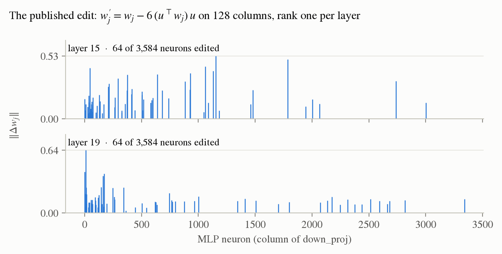
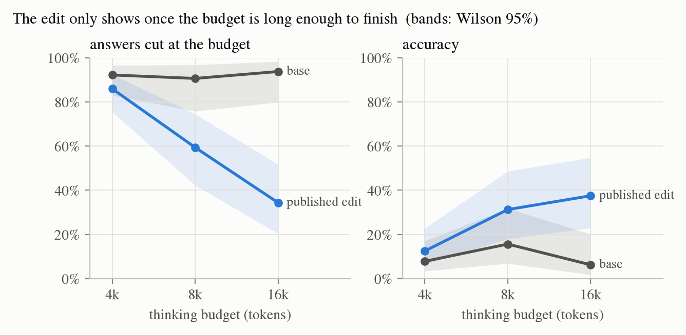
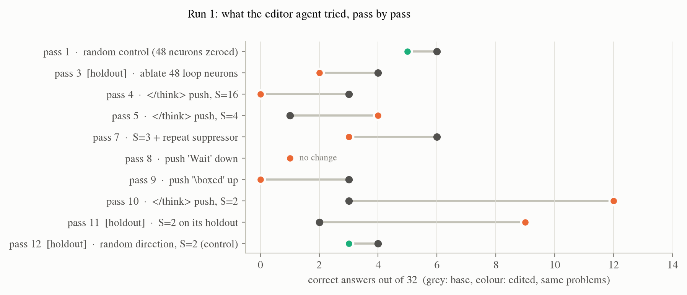
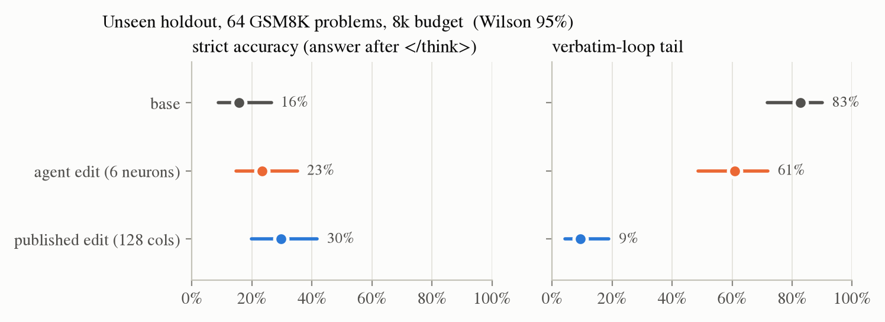
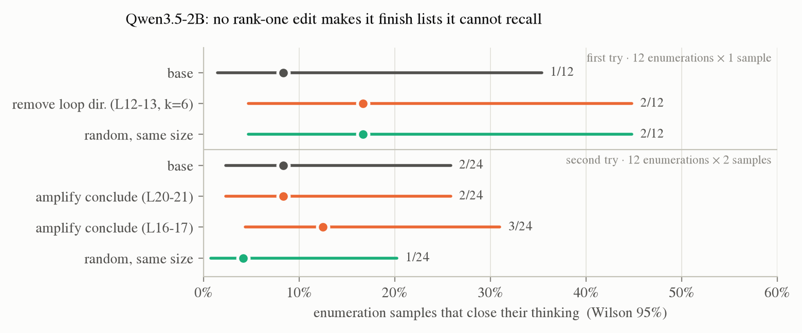

# Rank-One Weight Edits Against Thinking Loops in Qwen3.5: Anatomy, Transfer to 2B, and Search by a Coding Agent

A small replication and extension of *Sparks of Weight-Space Programming* (Takehi et al., 2026), run with MLX on one Apple Silicon laptop (M5, 24 GB).

## Abstract

Takehi et al. (2026) report that a gradient-free edit of the weights of Qwen3.5-0.8B reduces its thinking loops. We dissect the published edit, test whether the same recipe transfers to Qwen3.5-2B, and ask whether a coding agent with a numpy-only weight kernel and a budget of forward passes finds a working edit without being told the answer. The published edit changes 0.017 % of the language-model weights: in two MLP down-projections, 64 columns each have their component along one direction reversed and amplified (factor k = 6). On 32 GSM8K problems at a 16k-token budget it lowers the verbatim-loop rate from 94 % to 19 % and raises accuracy from 6.2 % to 37.5 % (10 problems rescued, 0 regressed), whereas at a 4k budget truncation hides most of the effect. The recipe does not transfer: Qwen3.5-2B loops on 13 of 14 enumeration prompts, and a linearly separable loop direction exists (held-out AUC 0.98 to 0.999), but neither removing it nor amplifying a "conclude" direction changes how often the model finishes compared with random controls. The agent (Claude Code) found a different six-column edit; on 64 unseen problems strict accuracy moved from 15.6 % to 23.4 % (sign test p = 0.27), against 29.7 % for the published edit (p = 0.035). The main limitations are small samples (20 to 64 prompts with one or two samples each), budgets of 6k to 16k tokens instead of the source paper's 32k, and a single agent run.

## 1. Setup

**Models.** Qwen3.5-0.8B (revision `2fc0636`), the edited checkpoint released by the source paper (`RikiyaT/Qwen3.5-0.8B-weight-space-programming`, revision `d1671a1`), and Qwen3.5-2B (revision `15852e8`). In this repository "base" means the unedited instruction-tuned checkpoint, not a pretrained-only model.

**Data.** GSM8K training problems (`data/gsm8k_train.jsonl`, MIT licence). For the 2B study, 32 open prompts (`data/open_prompts.jsonl`, 8 in French), labelled `enumeration` (14 requests for exhaustive lists of partly known facts, such as the 88 constellations or the French départements) or `other` (18 requests for advice, explanation or writing), and 20 unseen prompts for the edit screens (`data/open_holdout.jsonl`, 12 enumerations and 8 others).

**Generation.** Thinking mode on, the source paper's sampling (temperature 0.6, top-p 0.95, top-k 20, presence penalty 1.5), batched MLX generation (`scripts/loop_eval.py`). One sample per problem unless stated.

**Metrics.**
- *Cut*: the generation reaches the token budget before `</think>`.
- *Loop*: at least half of the 16-grams in the last 1,024 tokens already occurred earlier in that window (repetition score ≥ 0.5). Unlike *cut*, this separates a verbatim loop from a long chain of thought that is still progressing.
- *Accuracy*: the last `\boxed{}` matches the reference, numerically when both parse. *Strict accuracy* counts only an answer given after `</think>`.
- Paired comparisons report rescued and regressed problems and a two-sided exact sign test. Intervals in figures are Wilson 95 % intervals.

## 2. Method

**2.1 Dissecting the published edit.** `scripts/diff_weights.py` diffs the two 0.8B checkpoints tensor by tensor. For each changed matrix it tests the hypothesis w′ⱼ = wⱼ − k (u·wⱼ) u on the changed columns: the delta should then be rank one, and its coefficients should be proportional to the projections u·wⱼ.

**2.2 Hand-built edits on Qwen3.5-2B.** `scripts/capture_directions.py` re-reads saved generations teacher-forced and takes the difference of mean MLP outputs between positions inside a loop and positions before its onset, in the same samples: the loop direction u. `scripts/capture_conclude.py` contrasts the 64 tokens before `</think>` in answers that finish with positions inside loops: the conclude direction c. Both are split by sample and scored by AUC on the held-out half. `scripts/apply_edit.py` applies the published recipe to the 64 columns per layer that push most along the direction (remove u with k = 6 in layers 12–13, or amplify c with k = 3 in layers 16–17 or 20–21). Each edit has a control with a random direction on the same columns, rescaled to the same ‖ΔW‖.

**2.3 Editor agent.** The harness in `harness/` follows the rules of the source paper. The editor is Claude Code (Opus 5.5), run headless by `run_agent.sh`, and is not told what the published edit is.
- *Kernel*: numpy only, in an interpreter without MLX, so the agent can read weights but not run the model. `save_edit` rejects edits to the embedding, the output head and the final norm, and whole-tensor rescaling.
- *Forward passes* are budgeted (`./fwd`, 12 passes in run 1). `generate` answers 32 GSM8K problems at 8,192 tokens with the base model, the edited model or both; `read` records MLP activations teacher-forced.
- *Isolation*: the agent sees 1,500 dev problems. The 64 holdout problems stay outside its workspace, reads of the repository, the model caches and `~/.claude` are denied, and its only tools are `./kpy`, `./fwd` and file tools inside the workspace.
- *Imposed method* (`harness/task.md`): a dev/holdout split before any edit, paired comparisons, a control for every claimed effect, and a written report.

`harness/finalize.py` then evaluates the agent's final edit on the 64 holdout problems at 8,192 tokens, next to the base model and the published edit.

## 3. Results

Every number below is recomputed from the versioned files in `results/` and `runs/` by `scripts/report.py`, which writes `results/summary.json`.

### 3.1 Anatomy of the published edit

<picture>
  <source media="(prefers-color-scheme: dark)" srcset="figures/fig1_edit_anatomy-dark.png">
  
</picture>

*Figure 1. Norm of the weight change per MLP neuron (column of `down_proj`) in the two edited layers.*

Only 2 of the 320 language-model tensors change, `mlp.down_proj` in layers 15 and 19, with 64 of 3,584 columns edited in each (0.017 % of the language-model weights; relative change ‖ΔW‖/‖W‖ of 0.106 and 0.081). On the changed columns the delta is rank one (share of the first singular value 1.000), and its coefficients correlate at −1.000 with the projections u·wⱼ, with k = 6.0 in both layers. The two layers use nearly the same direction (|cos| = 0.85). With k = 6 the component along u is reversed and amplified five times rather than removed, so the edited neurons now write against the loop direction. This matches the single-neuron sign inversion reported by Lazaridis et al. (2026).

### 3.2 The effect depends on the token budget

<picture>
  <source media="(prefers-color-scheme: dark)" srcset="figures/fig2_budget-dark.png">
  
</picture>

*Figure 2. Share of answers cut at the budget, and accuracy, for the base model and the published edit (Qwen3.5-0.8B, GSM8K; 64 problems at 4k, 32 at 8k and 16k).*

At 4,096 tokens the two models look alike: 92 % and 86 % of answers are cut, and accuracy is 7.8 % and 12.5 %. At 16,384 tokens the loop rate falls from 94 % to 19 %, accuracy rises from 6.2 % to 37.5 % (10 rescued, 0 regressed, p = 0.002), and the share of answers that close their thinking rises from 6 % to 66 %. The edited model's correct answers at 16k have a median length of 10.9k tokens: the edit stops the model from spiralling, it does not make it shorter. A short budget cuts long productive chains and loops alike, so a loop metric should score repetition, not truncation.

### 3.3 Search by a coding agent

<picture>
  <source media="(prefers-color-scheme: dark)" srcset="figures/fig3_agent_trajectory-dark.png">
  
</picture>

*Figure 3. Run 1: correct answers out of 32 for the base model (grey) and the agent's edit (colour) in each generation pass, on the same problems. Passes 2 and 6 were activation reads.*

The agent's path, from its notes and report in `runs/run1/`:
- Zeroing 48 loop-selective neurons did nothing (pass 3: 4/32 for base, 2/32 edited). The agent concluded that these neurons "report the loop but don't drive it", and reused six of them (layers 20–23) as detectors: it added to their output columns a direction that raises the `</think>` logit, an "if looping, close thinking" circuit.
- Strong doses ran away. At S = 4 and 16 (passes 4 and 5), every edited answer closed its thinking, and the agent's report describes `</think></think>…` repeated until the budget; at S = 3 (pass 7) `</think>` was also inserted mid-sentence. The agent's note: "any token pushed by the detectors, once emitted, is itself a repetition, so it feeds the detectors".
- Two lexical edits, pushing "Wait" down and `\boxed` up, failed and were dropped. The second targeted a weakness of the grader at the time, which accepted a `\boxed{}` inside unfinished thinking; strict accuracy closes it.
- At S = 2 the edit scored 2/32 → 9/32 on the agent's own holdout (pass 11), while a random direction of the same size scored 4/32 → 3/32 (pass 12).

The run took 91 turns over two rounds, 3.2 hours, and $4.03 at list price (the `total_cost_usd` of the last CLI result row, which is cumulative over the resumed session).

### 3.4 Independent check on unseen problems

<picture>
  <source media="(prefers-color-scheme: dark)" srcset="figures/fig4_holdout-dark.png">
  
</picture>

*Figure 4. Strict accuracy and loop rate on 64 GSM8K problems the agent never saw, 8k budget, one sample each.*

| | Strict accuracy | Rescued / regressed (p) | Loop rate | Edited weights |
|---|---|---|---|---|
| Base | 15.6 % | | 82.8 % | |
| Agent edit | 23.4 % | 9 / 4 (0.27) | 60.9 % | 6 columns, layers 20–23 |
| Published edit | 29.7 % | 12 / 3 (0.035) | 9.4 % | 128 columns, layers 15 and 19 |

The two edits are different solutions. The agent's edit directions have |cos| 0.03 to 0.04 with the published direction. The published edit removes the loop; the agent's edit adds an exit that the model overuses: 55 of its 64 answers close their thinking, but 33 of those 55 still end in a verbatim loop and 38 emit `</think>` more than once. The search budgets also differ: the source paper describes 50 forward passes at 32k tokens for its agent, whereas this one had 12 at 8k, seven of which (passes 4 to 10) went to setting the dose and testing variants.

### 3.5 Negative result: Qwen3.5-2B

<picture>
  <source media="(prefers-color-scheme: dark)" srcset="figures/fig5_2b_negative-dark.png">
  
</picture>

*Figure 5. Qwen3.5-2B: share of enumeration samples on unseen prompts that close their thinking, for the base model, each edit and its random control (6k budget).*

The 2B fails differently from the 0.8B. On GSM8K at 16k tokens it loops on 19 % of problems and reaches 46.9 % accuracy; its failure there is long thinking. On open prompts it loops on 13 of 14 enumerations (none finishes within 16k tokens) and on 3 of the 18 other prompts.

The loop direction separates loop from pre-loop positions with held-out AUC 0.983 to 0.999 in layers 8–15, and has cosine 0.90 to 0.95 with mean(loop) − mean(clean answers). The conclude direction reaches AUC 0.94 to 0.97 in layers 4–22, and in layers 9–15 it is nearly the opposite of the loop direction (cos(c, −u) = 0.90 to 0.92; 0.75 in layers 20–21).

Neither edit changes the outcome. On 12 unseen enumerations, removing the loop direction reduces verbatim loops from 11 to 6 (random control: 8), but thinking closes in 2 cases, against 1 for base and 2 for the control. The verbatim repeats turn into non-verbatim self-correction ("*Wait, I am hallucinating dates. I need to stop and get the actual facts.*"). With two samples per prompt, amplifying the conclude direction closes 2 and 3 of 24 enumeration samples, against 2 for base and 1 for the control, and slightly lowers the closing rate on the 16 samples of other prompts (14 and 13, against 16). This loop appears to come from facts the model cannot recall rather than from a single-direction defect, consistent with the limit the source paper reports on Gemma 3 270M.

## 4. Limitations

- **Small samples.** 20 to 64 prompts with one or two samples each: effects below about 10 points are within noise, and the 2B screens can only detect large changes.
- **Short budgets.** The source paper evaluates at 32k tokens; the numbers here use 4k to 16k.
- **One agent run.** The agent's path depends on its budget and on sampling.
- **Confound in the 2B loop direction.** Loop positions always come later in the text than pre-loop positions, so part of the AUC may reflect position.
- **Grader.** All stored rows were regraded (`scripts/regrade.py`) after fixing a parsing bug that marked `\$`-prefixed answers wrong. Answers without `\boxed{}` count as wrong, so accuracy is a lower bound.
- **Sampling.** The committed runs were generated without a fixed seed. `loop_eval.py` now seeds MLX (`--seed`), so a rerun matches them in distribution, not token for token.

## Reproducibility

```sh
make setup            # uv environment from uv.lock (Python 3.12, MLX)
make report figures   # results/summary.json and figures/, from the committed results (no model needed)
make test             # grading and loop-metric tests

make models           # download the three checkpoints at the pinned revisions (about 7.6 GB)
make anatomy          # Sec. 3.1, a few seconds
make eval-budget      # Sec. 3.2
make eval-2b directions screens-2b                            # Sec. 3.5 (edits-2b rebuilds the 2B edits)
make kernel-env workspace agent finalize WS=~/ws-runs/run2   # Sec. 3.3 and 3.4
```

The model targets need an Apple Silicon Mac. A 32-problem pass at 8k tokens takes about 9 minutes per model on an M5 (median over the agent's passes). The `agent` target calls the Claude Code CLI and needs an Anthropic account. Long runs append results per batch and resume where they stopped.

| Result | Target | Script | Result files |
|---|---|---|---|
| Sec. 3.1, Fig. 1 | `anatomy`, `fig1` | `scripts/diff_weights.py` | `results/edit_anatomy.json` |
| Sec. 3.2, Fig. 2 | `eval-budget`, `fig2` | `scripts/loop_eval.py` | `results/loop_eval_{base,wsp,08_base,08_wsp}_*` |
| Sec. 3.3, Fig. 3 | `agent`, `fig3` | `harness/` | `runs/run1/` |
| Sec. 3.4, Fig. 4 | `finalize`, `fig4` | `harness/finalize.py` | `results/final_run1.json`, `results/loop_eval_final_run1_*` |
| Sec. 3.5, Fig. 5 | `eval-2b`, `directions`, `screens-2b`, `fig5` | `scripts/capture_*.py`, `apply_edit.py`, `export_directions.py` | `results/loop_eval_{2b,ho,ho2}_*`, `results/directions_2b.json` |
| All quoted numbers | `report` | `scripts/report.py` | `results/summary.json` |

`results/texts_*.jsonl` hold the prompt and generated token ids of each run, used for teacher-forced reads. `runs/run1/` holds the agent's notes, scripts, final report, pass summaries and transcript (local paths replaced by `~` and `<repo>`). `docs/lab-notes.md` is the chronological record of the experiments.

## References

- Takehi, Teoh, Zhang, Khattab. *Sparks of Weight-Space Programming*. 2026. [Blog post](https://rikiyat.github.io/blog/weight-space-programming), [logs](https://github.com/RikiyaT/lm_understand-logs), [edited model](https://huggingface.co/RikiyaT/Qwen3.5-0.8B-weight-space-programming).
- Lazaridis et al. *When Can One Neuron Fix Repetition Loops in LLMs?* [arXiv:2606.13705](https://arxiv.org/abs/2606.13705), 2026.

## License

Code released under the MIT license. Qwen3.5 weights are under Apache-2.0; GSM8K is under MIT.
